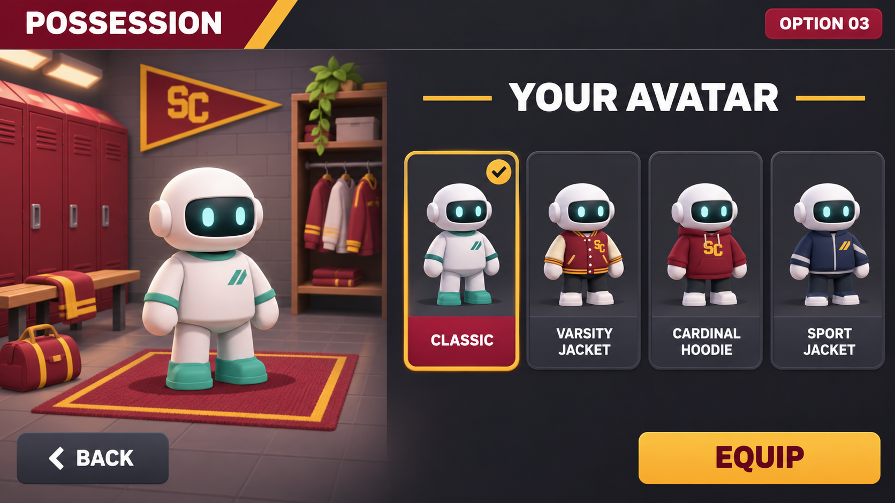
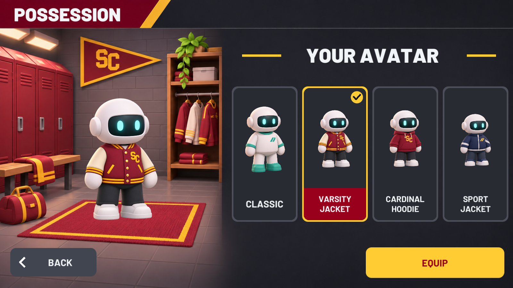
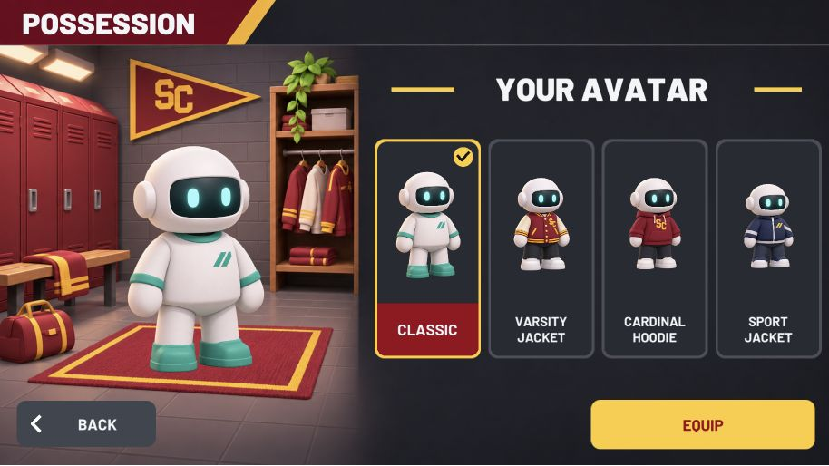
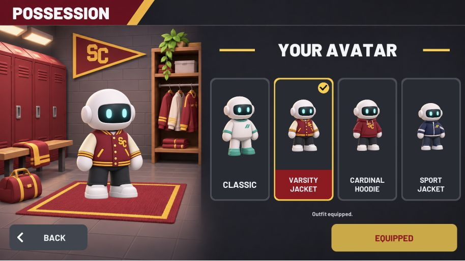
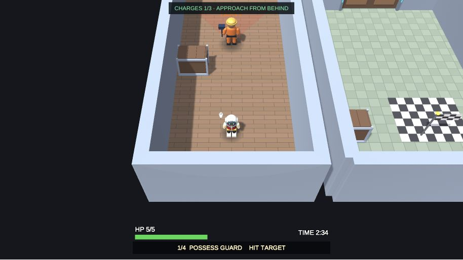

# USC avatar wardrobe — verification

28/28 focused Unity 6000.3.22f1 PlayMode checks passed: AvatarWardrobeTests, ReferenceMenuTests, CharacterMainGoalTests, CampaignOrderTests, Level4MenuTests and tutorial menu entry.

The wardrobe tests failed before implementation because the Avatar entry point did not exist. Final checks cover all four saved outfits across the four campaign stages, actual possession/ejection, Back discarding unapplied choices, corrupt preference fallback, NPC uniform separation, physical player controls and menu pointer hit testing.

Artwork is separated into a locker-room background and four transparent outfit portraits derived from the approved reference. Text, cards, selected border/checkmark, Back and Equip are native interactive controls. The gameplay Spirit uses lightweight 3D clothing and matching silhouette/colors; the detailed menu portraits are illustrations, not screenshots of those gameplay meshes.

## Browser build

WebGL build succeeded. Chrome verified actual clicks through Avatar, all four outfit previews, Equip, browser refresh restoring Varsity as equipped, Back discarding an unapplied Sport preview, Level 1 launch with the saved varsity clothing, and keyboard movement. The default WebGL canvas is fitted to laptop windows without clipping its controls. Older builds are untouched.

