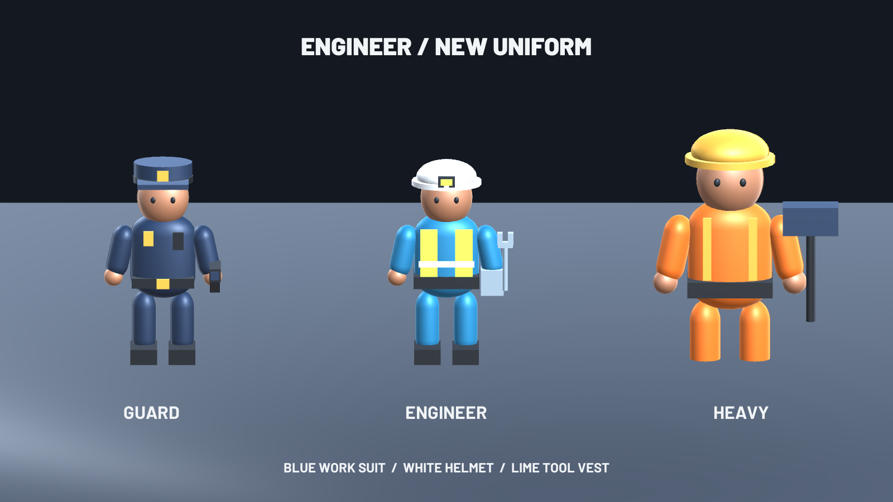

# Engineer role readability — 25 November 2026

Engineers now have blue workwear, a white hard hat with a small headlamp, a lime reflective tool vest, a metal toolkit and a visible wrench. Guard navy/sidearm and Heavy orange/yellow/hammer remain distinct.

The change follows the EngineerEnemy component, so every Engineer receives the same recognizable role uniform regardless of level numbering. The existing white-body possession cue remains; workwear returns to blue after ejection. Equipment is visual-only and adds no colliders or ability changes.

Verification: 26/26 existing Level4PresentationTests and CharacterMainGoalTests passed. The comparison below renders the actual character models from the authored level, facing the camera.

