# Gold UI Part 1

Branch `codex/gold-ui-part1` belongs to the original `ruturaj-mohalkar-25/POSESSION` repository and starts at integration `6b87fb0`. This ports the existing visual foundation and addresses the call feedback. Menus, HUD, tutorial, enemy models and Level 4 remain with their assigned owners. No scene or shared prefab assets are rewritten.

## Changes and diagnosis

- Wood/tile/stone floors, muted walls and the existing small corner cabinets install when a campaign scene loads.
- The original floors have ten coplanar overlapping pairs: three in Level 1, two in Hunted and five in Warehouse. The largest overlap is 256 square metres. Several have different materials, and even shared materials have different object-relative UV origins. This causes depth competition as the camera moves.
- `GoldFloorSurface` partitions the existing floor rectangles into disjoint visible patches, batched by material and height. Each piece of the original walkable union is drawn once, using world-aligned UVs. Original floor colliders and transforms remain intact. This also removes same-material overlap; it does not rely on changing draw order or adding a depth bias.
- The player has a collar only. The diamond mesh and material are removed. The collar stays outside the body's surface to avoid intersecting it, follows real possession/ejection and hides on death/completion. Existing body whitening and HUD health remain owned by their existing systems.
- Actual wood panels and handles replace the lock emblem on all seven campaign doors. Both faces are styled. The existing `SlidingDoorView`, target lamps, unlock requirements, animation and blocker remain in control. When the leaves retract completely, all added panel/handle renderers hide so the opening stays clear.
- Empty layer names are explicitly quoted in `TagManager.asset` to resolve Unity's native YAML parse error. Layer names and indices are retained.

## Validation

Unity **6000.3.22f1**, 15 November 2026:

- **237/237 campaign/shared PlayMode checks passed**, zero failures or skips in that selection.
- **9/9 focused Part 1 and existing door tests passed**. Coverage includes disjoint floor rendering and union coverage in all three scenes, real possession/ejection without an overhead symbol, actual target-based door unlocking and clear openings, and duplicate-installation safety.
- Independent editor comparison confirms every original collider's serialized data, transform and scale is unchanged by installation in all three campaign scenes.
- Source comparison confirms no edits to campaign scene assets, shared prefabs, existing menu/HUD/core code or tutorial files.

Tutorial-specific `TutorialTests` and `TutorialEffectsTests` are excluded from the campaign run. Current integration restores a popup that pauses time, while old tutorial fixtures include a scaled wait that expects no coaching. That baseline mismatch is outside Part 1; the tutorial is not changed to satisfy it.

## Screenshots

These are rendered from the actual scenes using the same before/after camera positions.

| Area | Before | After |
| --- | --- | --- |
| Level 1 | 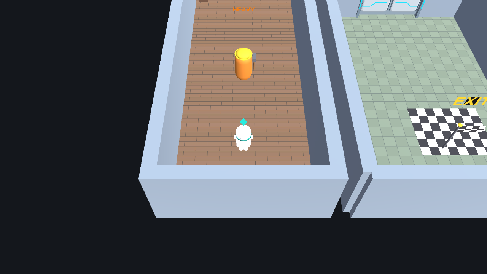 | 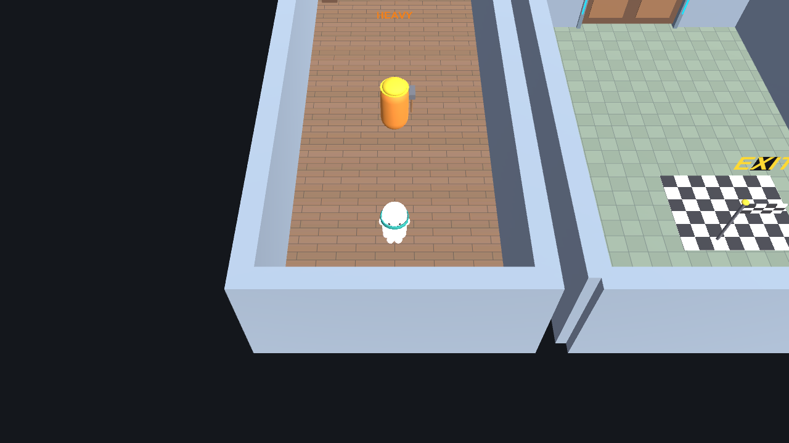 |
| Level 1 door | 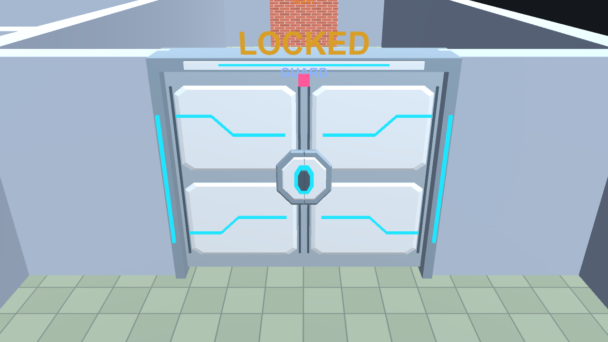 | 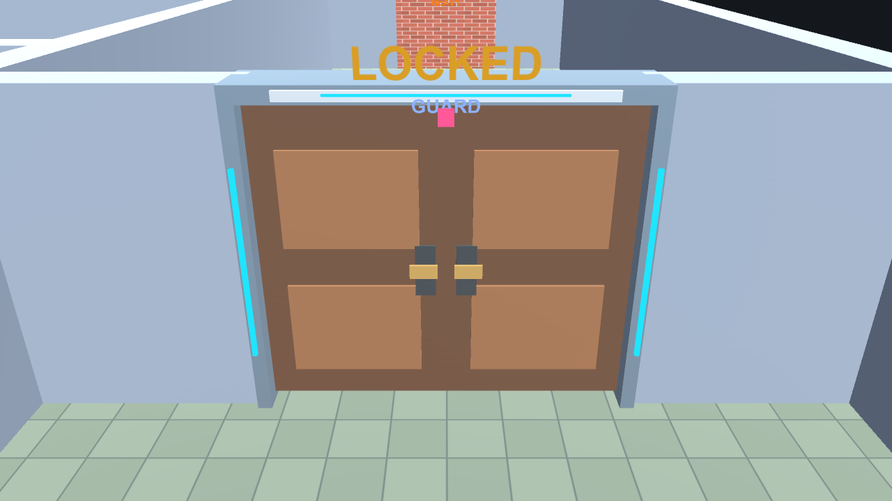 |
| Hunted |  | 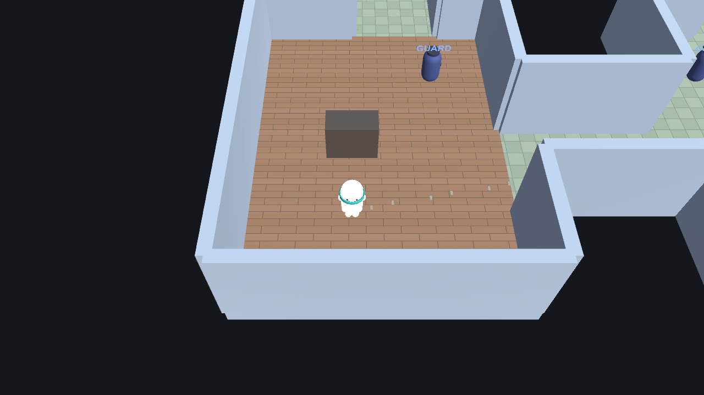 |
| Hunted door | 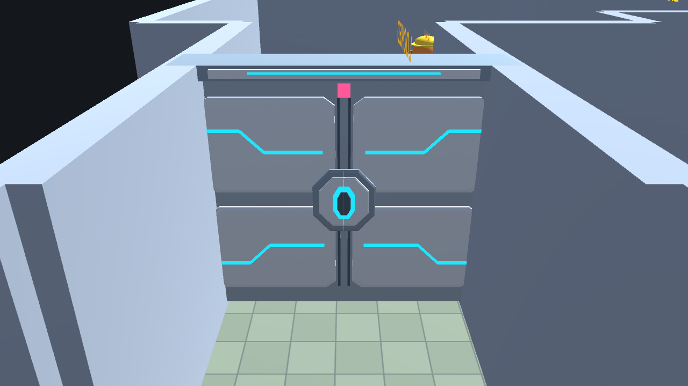 | 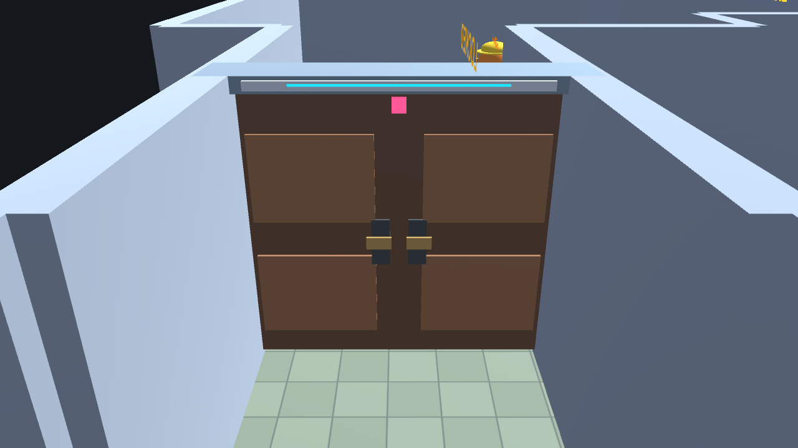 |
| Warehouse | 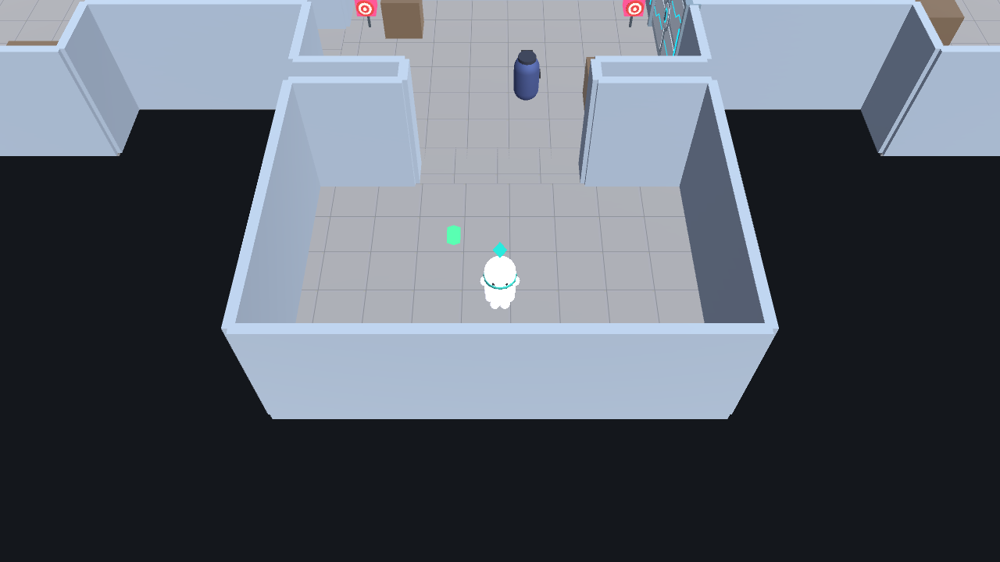 | 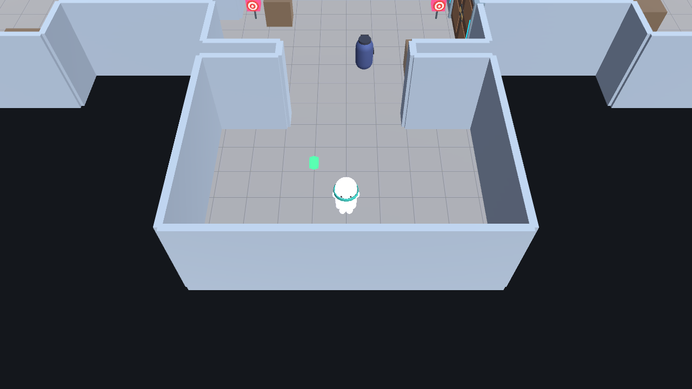 |
| Warehouse door | 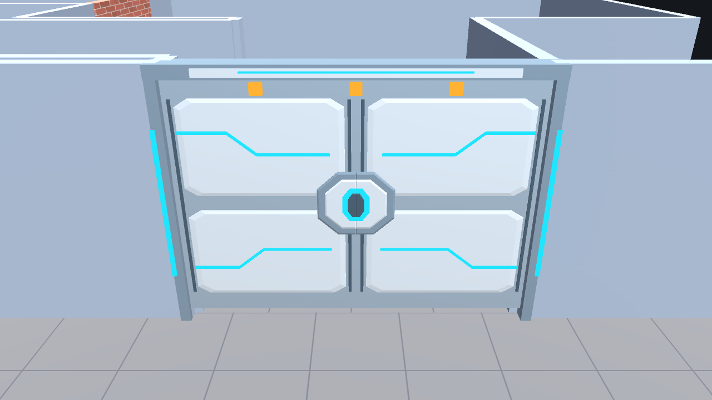 | 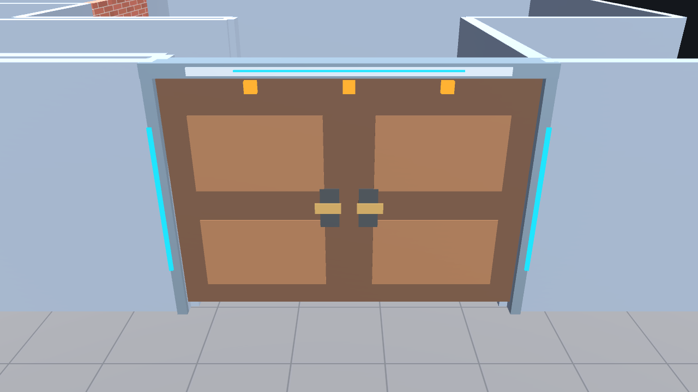 |

## Reproduce

Open MainMenu and enter each campaign level. Cross the fork/right-wing and top/right-wing joins in Level 1, the R7/corridor joins in Hunted, and the entry/sorting/service joins in Warehouse. Check floor stability while moving, possessing and ejecting. Hit each door's real targets: the same original blocker should unlock while both wood leaves retract. Nothing appears above the player to imply health.

Batch entry points:

- `Possession.Editor.GoldPart1Tools.Diagnose`: log original coplanar floor pairs.
- `Possession.Editor.GoldPart1Tools.ValidateGeometry`: compare original colliders before/after installation.
- `Possession.Editor.GoldPart1Tools.CaptureAfter`: capture actual-scene reference images without saving scenes.
- `Possession.Editor.GoldPart1Tools.BuildWebGL`: release browser player in `Builds/Gold-Part1`, with gzip fallback and hashed assets.

The generated build is ignored by Git. Ruturaj reviews/merges into integration; Ansh can review this branch independently of Part 2.
