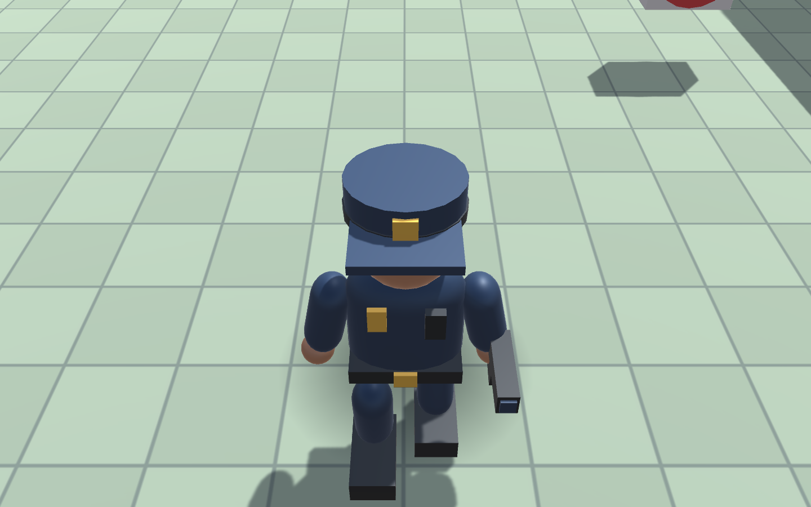
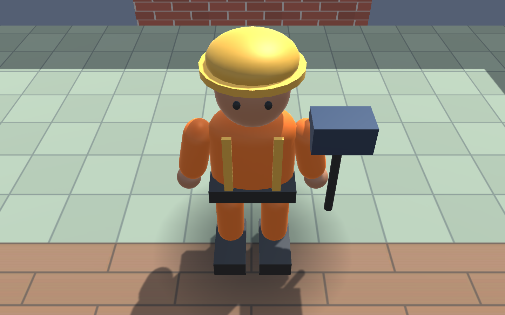

# Main goal: shadows, readable characters and solid cover

Approved F shadows combine directional silhouettes and soft floor contact for Spirit and all enemies. Police have a navy uniform, cap, badge and visible sidearm. Spirit is white/teal. Heavy has an orange work uniform, hardhat and hammer.

Spirit, police and Heavy have two visible legs and boots. Feet alternate with actual distance travelled, settle when movement stops and freeze during pause. Animation moves only visual pieces. Possession colours, visible-body countdown blink, combat warning tint and Heavy smash guide stay connected to gameplay.

Flat mat-like props are replaced by **2.8 × 2.2 × 1.8 m solid wooden hiding crates**. Each intentionally adds one enabled blocking BoxCollider. Cover stops movement, actual enemy sight and the rendered red vision cone, and avoids full patrol segments and objectives. Crates join camera occlusion fading. Original authored colliders are unchanged. Vision cones use 96 ray samples and an expanding hit buffer.

## Validation

The corrected main build passed **310/310 PlayMode tests**, zero failures/skips. New tests exercise actual sight and cone obstruction, distance-driven stride/idle/pause and retained Heavy guide visibility. Existing full campaign solution, patrol, possession/ejection, combat, jumping and occlusion tests also passed.

Scene captures use an inspection camera with HUD hidden. Closeups temporarily hide intervening walls/world labels. Stride images advance the same distance-driven pose by small staged root movements; they are inspection poses rather than recordings of human play. The runtime build uses normal cameras and visibility.

Review order: existing #84 → main #85 → USC stretch #86. Main playable build: https://utkarsh-landge.github.io/posession-gold-playtest-2026/playtest-feedback/main-goal/
