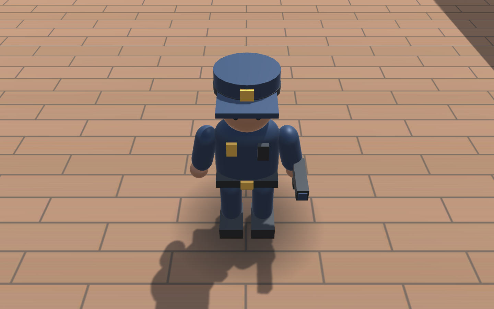
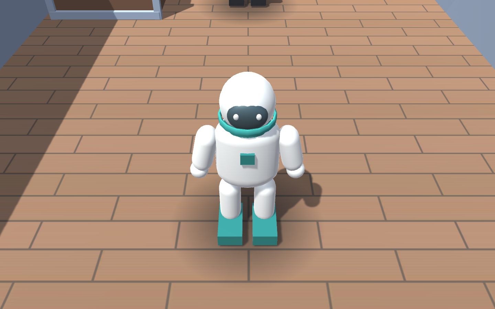
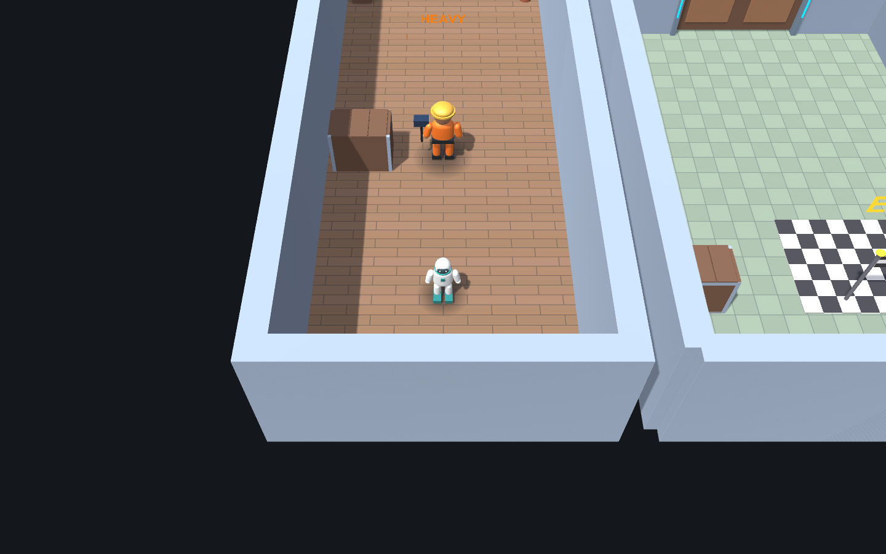

# Main goal: character shadows and avatars

Approved style F: soft directional silhouette plus stronger floor contact. Covers Spirit, autonomous Guards and Heavies, controlled hosts, runtime-spawned enemies and Tutorial. The NPC stamp is hidden while its host is possessed so it does not double the player shadow.

The Spirit has a white/teal humanoid avatar. Guards have navy clothing, a peaked cap, gold badges, duty belt/radio and a visible sidearm. Only clothing turns white in possession. Existing root renderers remain as logical visibility/bounds proxies; gameplay transforms, colliders and abilities are retained.

Countdown blink targets visible body pieces; equipment retains visibility. Attack warning property blocks bind to the new model. Hide/show follows possession, death, component enable/disable and scene transitions. Global lighting settings restore after the final owner leaves, including additive scenes.

## Review order

This is a focused followup to existing PR84 (base branch codex/playtest-feedback). The USC stretch PR is stacked above this main PR and contains its own room-art/corner changes. Neither PR is merged automatically.

## Verification

Full gameplay suite: **304 passed, 0 failed**. After the additional fallback lifecycle edge fix, **31/31 avatar, visible-body blink, proportion and level-presentation checks passed**. The final combined stretch suite will include these same runtime changes. Build and browser evidence follow. New regression coverage exercises real possession/ejection and shield retention, visible uniform versus cap colours, every stage/Tutorial avatar/shadow installation, no new colliders, component lifecycle, cloned actors, death, attack warning tint and additive lighting restoration. Existing countdown-blink timing/pause/restoration tests now observe the visible torso instead of the hidden legacy capsule.

Native closeups are inspection camera renders; any wall between the camera and character is temporarily hidden for the capture only. Gameplay overview and browser evidence are recorded separately.

The approved preview used Unity primitives; built-in FBX capsule/sphere meshes have different unit bounds. Runtime pieces explicitly normalize those mesh dimensions, and the identity collar fits the humanoid torso/head instead of the legacy capsule.

Release WebGL build succeeded (`Builds/MainGoal`). Collider fingerprints matched in all three campaign stages and Tutorial. These are actual Unity level renders.

The combined main+USC regression run passed **312/312 tests, 0 skipped**. Main-only review build: https://utkarsh-landge.github.io/posession-gold-playtest-2026/playtest-feedback/main-goal/ . Editor inspection lighting is explicitly released before changing scenes/building, retaining project quality settings.
