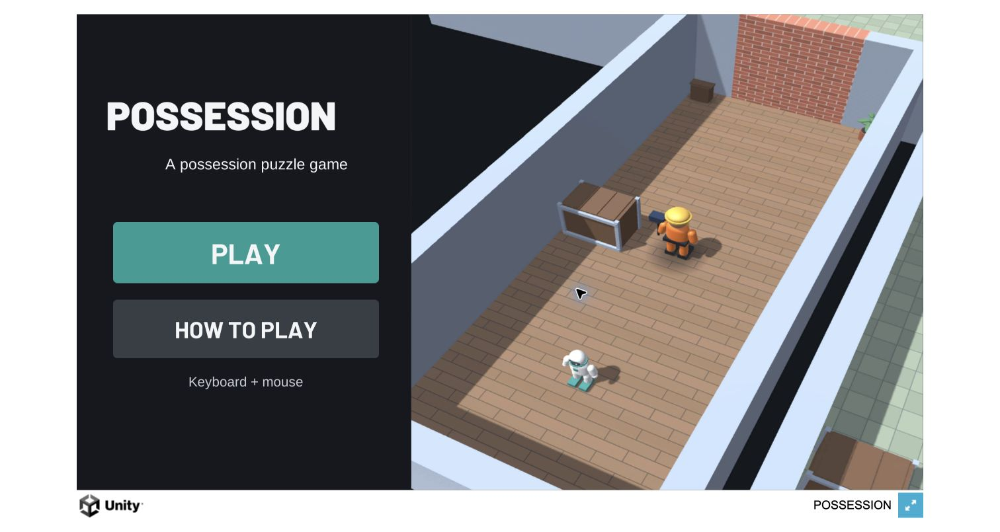
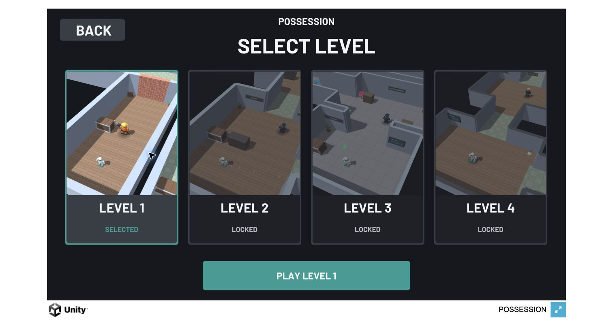

# Verification — 24 November 2026

Unity 6000.3.22f1 PlayMode: 10 passed, 0 failed (ReferenceMenuTests, Level4MenuTests, CampaignOrderTests, tutorial menu entry).
WebGL build: succeeded.
Chrome smoke check: Play opens level selection; locked Level 3 stays locked; Back returns home; How to Play opens Tutorial; Play Level 1 starts Level_03, the promoted first campaign stage.

Browser captures below show a fresh profile with only Level 1 unlocked. Four-stage routing with earned unlocks is covered by CampaignOrderTests.

## Artwork

Level1–4 images are captured from the actual authored stages. Regenerate via Possession.Editor.MenuReferenceBuild.CaptureArt. Barlow Black/Bold fonts are bundled under SIL OFL; license: Assets/Resources/Menu/OFL.txt.
