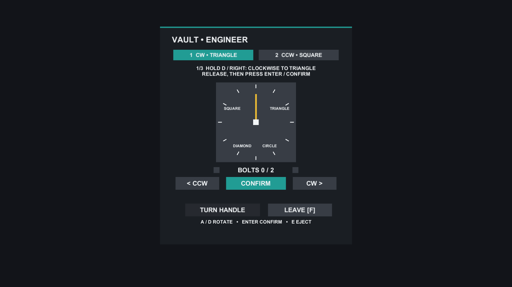

# Playtest fixes — 24 November 2026

## Reproduced wall exploit

Starting on reachable upper-floor cover, jump in place for 0.35 seconds, then move toward the room boundary. With the previous 8 m/s jump, Spirit can land on the 4.5 m wall and leave the intended upper-floor route.

The saved Level 4 scene and its authoring builder now use a 6.5 m/s jump. At default gravity, a jump from 1.7 m cover reaches roughly 3.85 m above the floor, below the wall top. Other stages keep their shared prefab jump setting. Wall dimensions, floor cutaway and stair geometry are unchanged.

Regression: `SpiritCannotJumpFromUpperCoverOntoTheBoundaryWall` failed before the fix (stood on wall), then passed. `SpiritCanStillJumpFromTheUpperFloorOntoCover` confirms ordinary cover access still works.

## Vault instructions

The dial now explains each current direction, symbol, release/confirm action and final handle step. Wrong alignment and wrong direction give different feedback. Combination, tolerance, possession timer and engineer requirement stay unchanged.

Regression: `VaultExplainsEachDirectionStopAndFinalHandle` failed before the fix (instruction missing), then passed.

## Finish-line investigation

Physical Spirit movement into the ready Warehouse exit completes the stage and its Next Level button loads Level 4. A regression uses actual Rigidbody movement rather than calling TryFinish directly. A possessed Guard also physically triggers extraction; pointer hit-testing confirms that decoration does not cover Next Level, and clicking it loads Level 4.

The reported finish failure has not been reproduced on current integration. No speculative completion-rule change is included.

## Checks

- New focused regressions: 4/4 passed; additional possessed-Guard extraction/button check: 1/1 passed.
- Full PlayMode run: 382 passed / 384 total. Two failures: the new Guard fixture initially staged Spirit beyond the exit-room wall (fixed fixture and reran: passed); `EnemyRouteW3Tests.Level02GuardsCompleteW3BehaviorChecks` expects five Guards but the saved Level 2 scene has seven.
- Baseline check with the original gameplay source restored: the same Level 2 patrol-count test fails, five expected / seven actual. This unrelated test/scene is unchanged here.
- Existing full-suite stair traversal, vault completion/pause/expiry and campaign-order tests passed.

