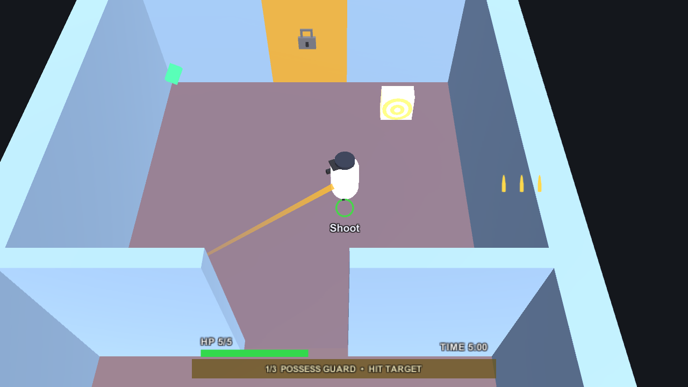
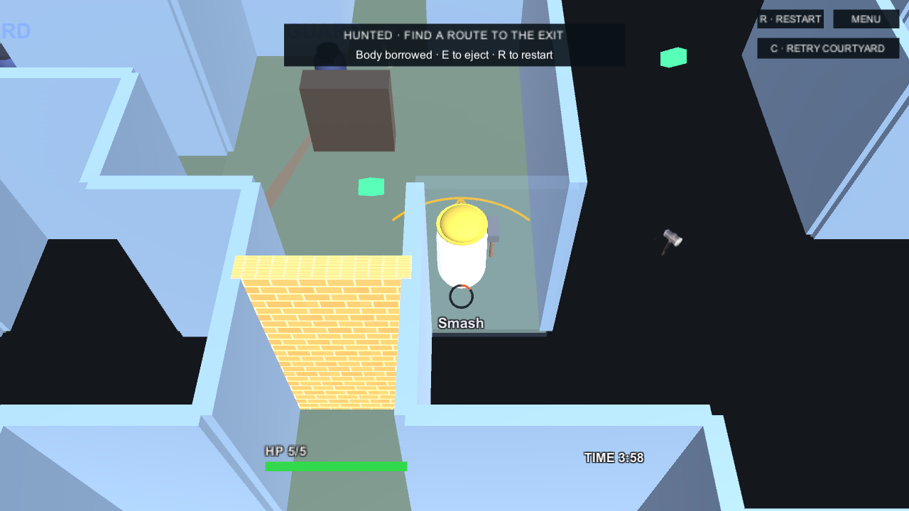
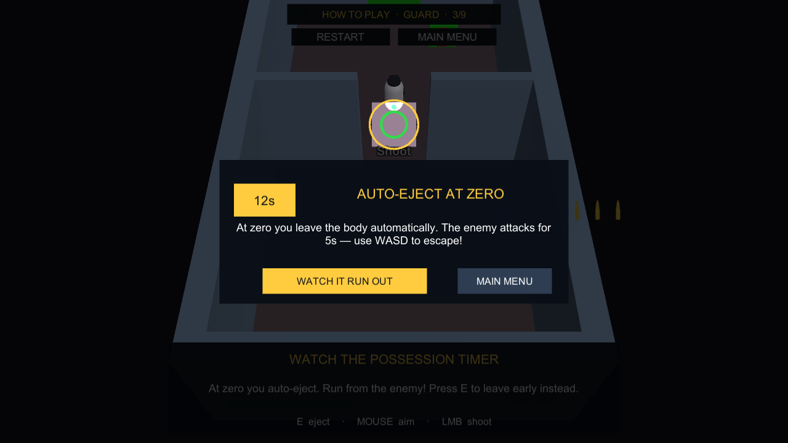

# C3 possession and beta HUD validation

Verified November 8, 2026, using Unity **6000.3.22f1**.

This branch combines the circular countdown from PR #65 (`bb55e2a`) with the latest beta HUD, ammo and camera changes from PR #68 (`46d5967`).

## Results

- Final full PlayMode suite: **181 passed, 0 failed, 0 skipped**.
- Fresh original PR #65 run: 154 passed out of 172, with 18 failures. The existing integration report at `78dd0f5` has the same 18 failing cases.
- Two new hostile-projectile regressions failed before the production fix: a raycast hit removed no HP, and duplicate callbacks removed two HP. Both now pass; the focused five-case verification also covers real tutorial damage, eject protection, target-puzzle exclusion and HUD cleanup.
- A separate native rendering check passed for Guard and Heavy in Levels 1–3, including movement, manual ejection and natural expiry, plus the paused tutorial clock spotlight. NPC combat was disabled during these staged captures; real attacks are covered by the PlayMode suite.

## Behavior covered

The ring stays below the white possessed body, retains equipment colours, and changes from green through amber to red without flashing. Its hint keeps a gap during tutorial zoom. Pause/re-enable, missed level-end events, offscreen hosts, material restoration and aim-line disposal have regression coverage.

Every saved level and Tutorial now uses the beta bullet/hammer sprites and camera offset. Ammo stays inside all screen edges on overlay and camera canvases. Level 3 uses the intended Heavy_03 spawn at z=7.

Tests retain the current five-metre ranges, two-second eject protection, five-second hostility, twelve-second tutorial possession, one starting Level 2 charge and three-charge capacity. Pickup tests explicitly start empty to isolate collection behavior; saved starting charges and retry restoration are checked separately. No tests are ignored or skipped.

## Reproduce

Open the project in Unity 6000.3.22f1, then use **Window → General → Test Runner → PlayMode → Run All**.

## Native previews

Guard with the circular timer, typed ammunition and bottom-centre status row:

Heavy with low remaining possession time:

Tutorial spotlight preserves the circle and hint spacing:

