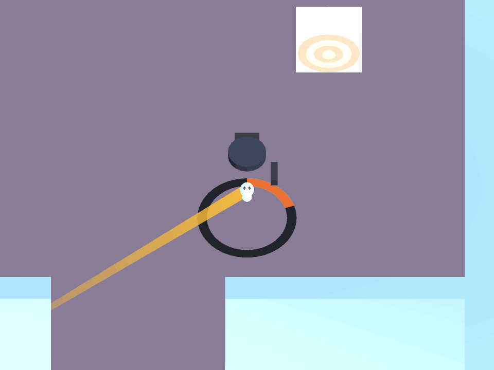
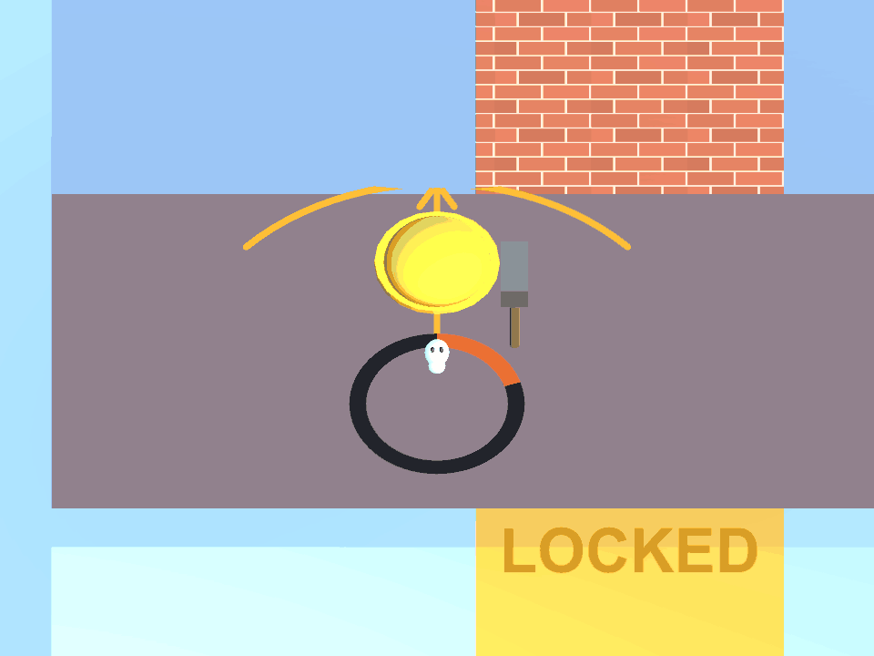

# C3 low-time body blink

This follow-up restores the warning requested in closed PRs #63 and #64 on top of the ground countdown merged in #65. It starts from integration `6b87fb0`, including the tutorial changes from #76.

## Behavior

- At 35% possession time or below, the possessed body blinks. The rate increases from 2 to 9 cycles per second as the timer approaches zero.
- The body keeps its white possession material. Hats, tools, ammunition, the aim line and the ground countdown keep their existing presentation.
- The warning changes only the body renderer's visibility flag. It does not replace materials, write material property blocks, disable the renderer component or touch colliders.
- Pause freezes the blink. Ejection, expiry, death, a disabled host, a disabled warning and level-end events restore the original visibility state.
- One warning is installed on each possession controller when a scene loads. It also handles enemies spawned later, with either a root body renderer or a child mesh. No scene, prefab or enemy AI changes are needed.

The old blink selected only child meshes, skipping the root body used by the saved levels. It also wrote the enemy's original colour over the newer white possession material. Both issues are avoided here.

## Validation

Verified November 11, 2026, with Unity **6000.3.22f1**:

- Focused warning and countdown checks: **28/28 passed** (13 new blink checks and 15 existing countdown checks).
- Remaining PlayMode suite, excluding the two obsolete tutorial fixtures described below: **246/246 passed, 0 failed, 0 skipped**.
- Native Guard and Heavy capture check: **1/1 passed**, recorded alongside that suite.

The warning checks cover Guard and Heavy acceleration, material and property-block preservation, equipment visibility, both ejection types, real expiry, invalid and replenished timers, pause, disable/re-enable, death, level end, unrelated enemy events, runtime-spawned hosts and installation across every saved level and Tutorial.

To reproduce, open **Window → General → Test Runner → PlayMode** and run `PossessedBodyBlinkTests` together with `PossessionTimerTests`.

The broader run selected all tests matching this filter, with `TutorialTests` and `TutorialEffectsTests` explicitly excluded:

```text
^Possession[.](Tests[.](?!Tutorial(Effects)?Tests)|Warehouse[.]Tests[.])
```

The unfiltered suite currently stalls in `TutorialEffectsTests.CompactTutorialNeverPausesForAHudSpotlight`: it waits on scaled time while the tutorial's intro popup has paused the game. A separate checkout of unchanged integration `6b87fb0`, without the blink code, also fails `TutorialTests.TutorialAutoStartsWithoutAModalOrPausedCoaching` because the lesson no longer starts before the intro is dismissed. These fixtures still expect the earlier automatic, unpaused tutorial. The full suite is not reported as passing.

## Native previews

Captured from Unity's gameplay camera with the possession timer held at two seconds to show the warning. The clips retain the captured frame timing; the ground ring remains steady while only the body blinks.

Guard:



Heavy:


