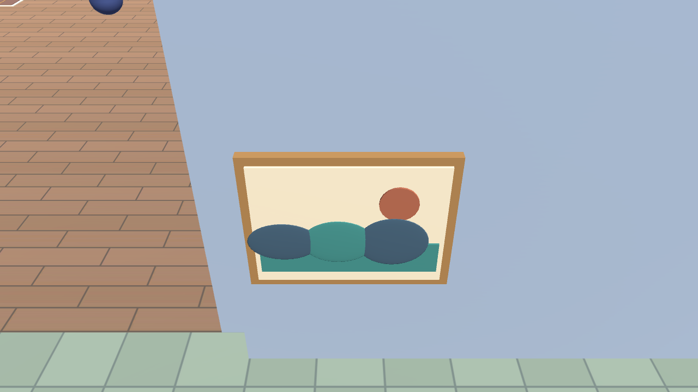
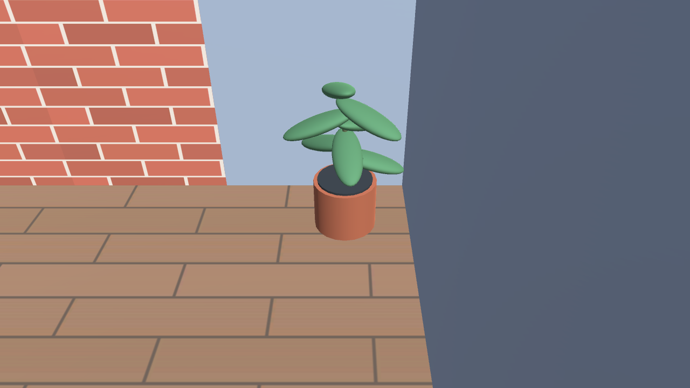
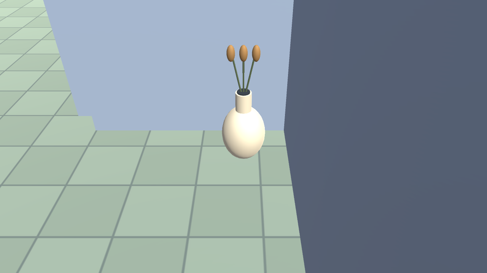
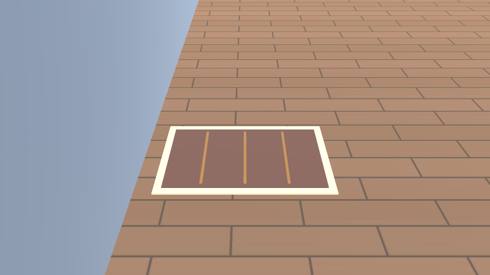

# Room decoration pass

Added framed abstract landscape paintings, wall-mounted TVs, terracotta potted plants, ceramic vases with dried stems, and woven floor mats. No sofa.

| Campaign | Paintings | TVs | Plants | Vases | Mats |
| --- | --- | --- | --- | --- | --- |
| Level 1 | 2 | 1 | 2 | 1 | 5 |
| Level 2 | 5 | 2 | 2 | 2 | 6 |
| Warehouse | 3 | 2 | 2 | 2 | 4 |

Props use shared low-poly geometry and a muted palette. Placement checks doors, objectives, pickups, actors, waypoints and existing cabinets. Mounted art follows wall fading. The visuals have no colliders and ignore raycasts. Runtime installation is idempotent and disposes owned materials and wall-mounted roots on scene unload. Campaign wall dressing installs after room signs to retain nameplate space.

Verification: 32/32 focused Unity presentation, door and wall-visibility checks pass. All five prop types are asserted in every campaign stage. Editor capture additionally compares original collider IDs before/after installation in all three stages. Release WebGL build succeeded.

Images are actual Unity scene renders with inspection cameras and the HUD hidden, not human gameplay captures.

