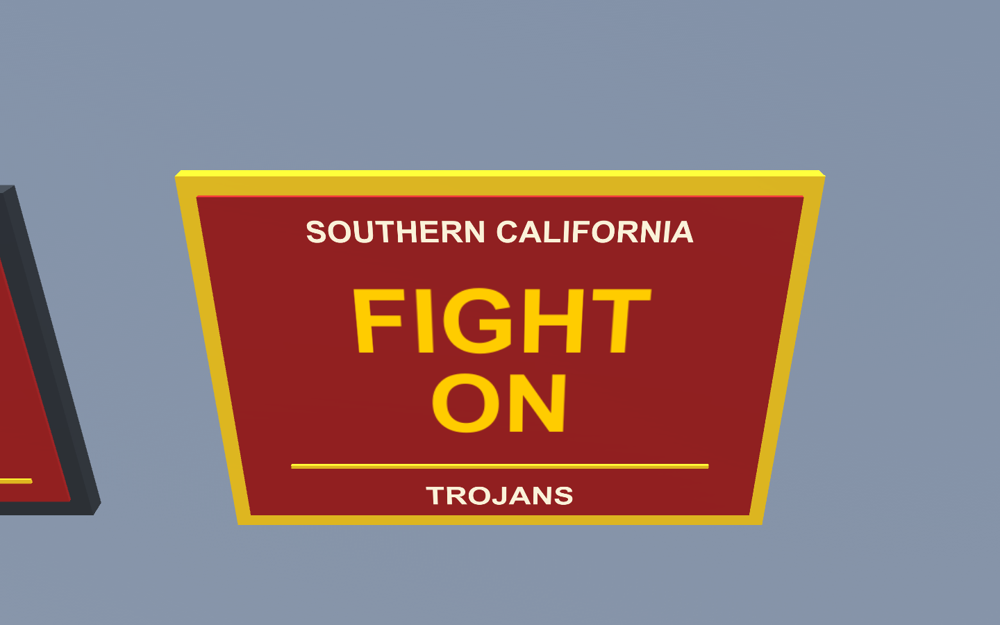
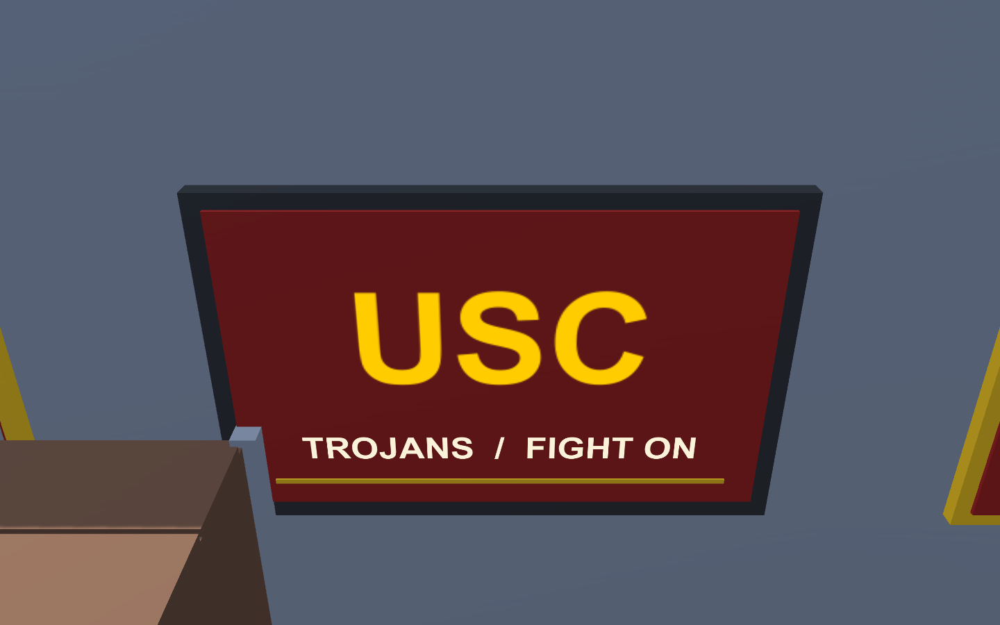
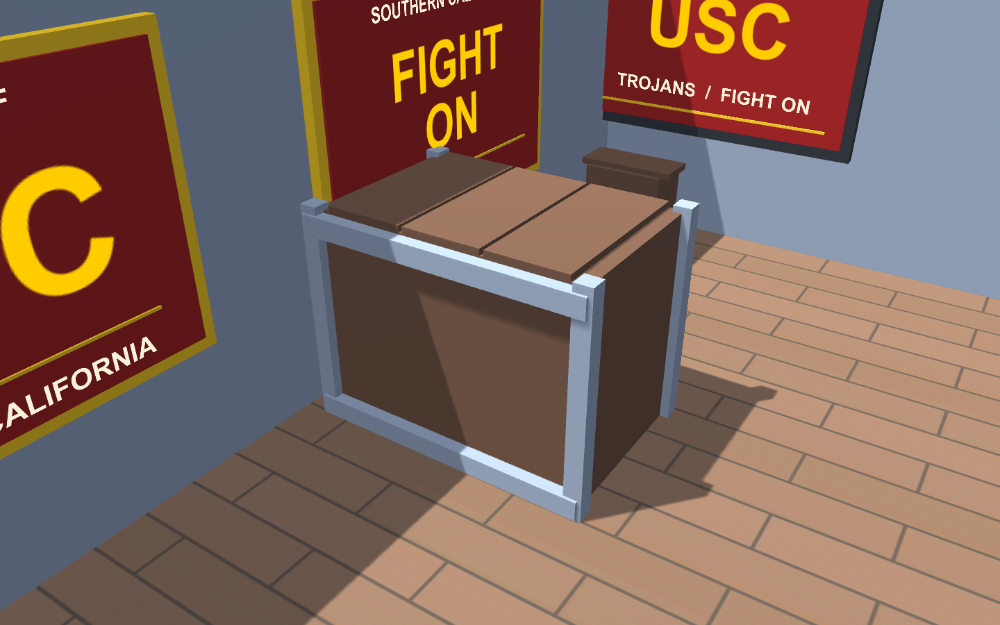

# USC room style correction release

USC, Fight On, Trojans, SC, LA and Beat UCLA typography now mounts on all four feasible interior wall directions. Long clear spans can hold multiple frames/TVs. Side-wall meshes and local text bounds turn correctly toward their room. Door, objective, room-sign and same-face artwork spacing remain clear. Safe corners retain artificial plants/vases. No sofa.

Includes the main goal's solid wooden cover, distance-driven Spirit/police/Heavy feet, F shadows and readable equipment. Crates remain opaque and their trim/lid faces are separated to prevent shimmer. Their enclosing blocking boxes intentionally change cover collision; original authored colliders remain unchanged.

Final combined full PlayMode suite: **319 passed, 0 failed, 0 skipped**. Additional focused stability suite: **46/46 passed**. Covers full campaign solutions/patrols, actual vision/cone obstruction, stride/idle/pause, collision/material stability, trim separation and all four artwork orientations with door/sign clearance.

PNG captures use repositioned inspection cameras and hidden HUD. Closeups temporarily hide intervening walls/world labels. Normal runtime cameras and visibility apply in the game.

Review order: #84 → #85 → #86.
