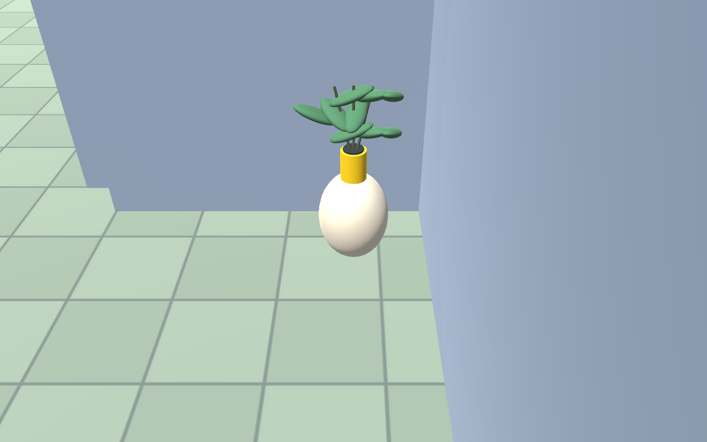
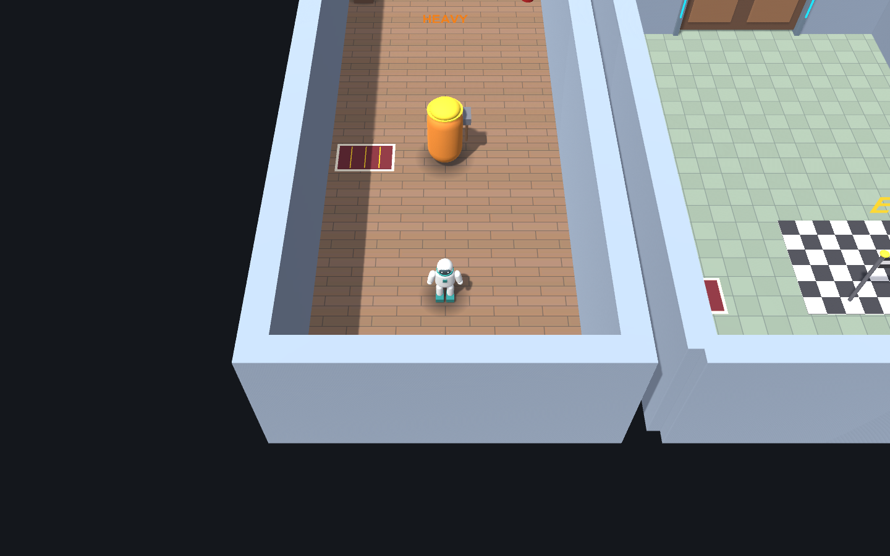

# USC room style: stretch build

Separate followup to the character/shadow main goal. Adds cardinal/gold USC, Fight On, Trojans, SC, LA and Beat UCLA wall typography, matching wall TVs, woven mats and artificial greenery in safe corners. No sofa. All four corners are considered per eligible room; doors, objectives, pickups, cabinets and complete patrol segments retain clearance. Props add no colliders.

Combined gameplay suite: **312 passed, 0 failed, 0 skipped**. Release WebGL build succeeded. Collider fingerprints matched before/after presentation installation in all three campaign scenes and Tutorial.

These PNGs are actual Unity scene inspection renders, with a repositioned camera and HUD hidden. Closeups temporarily hide intervening walls and world labels for inspection; the runtime build keeps normal visibility behavior. Browser gameplay verification is recorded separately.

