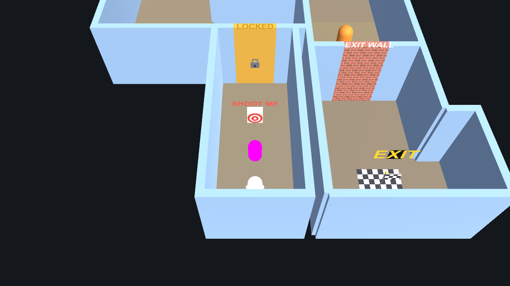

# POSESSION

POSESSION is a top-down action-puzzle game built in Unity. You play as a Spirit that can possess enemy bodies, borrow their abilities and eject at the right moment to navigate guarded rooms. Guards provide ranged attacks, Heavy enemies smash reinforced walls, and each level combines possession, combat and environmental puzzles.

## Play

[Play the WebGL build](https://ruturaj-mohalkar-25.github.io/POSESSION/)

## Controls

| Input | Action |
| --- | --- |
| `WASD` | Move the Spirit or possessed enemy |
| `Space` | Jump while in Spirit form |
| `E` | Possess a nearby enemy or eject from the current host |
| Mouse | Aim the Guard's ranged attack |
| Left mouse button | Use the possessed form's ability |

## Core loop

1. Explore as the Spirit and approach a host.
2. Possess a Guard to shoot targets and unlock doors.
3. Possess a Heavy to smash reinforced walls.
4. Eject before the possession timer expires and avoid the temporarily hostile host.
5. Enter the exit as the Spirit after completing the level's puzzles.

## Team

| Member | Primary responsibility |
| --- | --- |
| Ruturaj Mohalkar | Spirit, possession, shooting and puzzle systems |
| Ansh Parasher | Guard enemy behavior, patrol integration and QA |
| Omkar Shinde | Heavy enemy and smash behavior |
| Utkarsh Landge | Level design and greybox layouts |
| Ramya Sri Sushma Vasamsetti | HUD, UI and visual presentation |

## Development

- Unity 6.3 LTS (`6000.3.22f1`)
- Keyboard and mouse
- WebGL and desktop targets
- Native Unity PlayMode regression suite

The W3 enemy-route report is available in [Docs/P1-W3-QA.md](Docs/P1-W3-QA.md).
