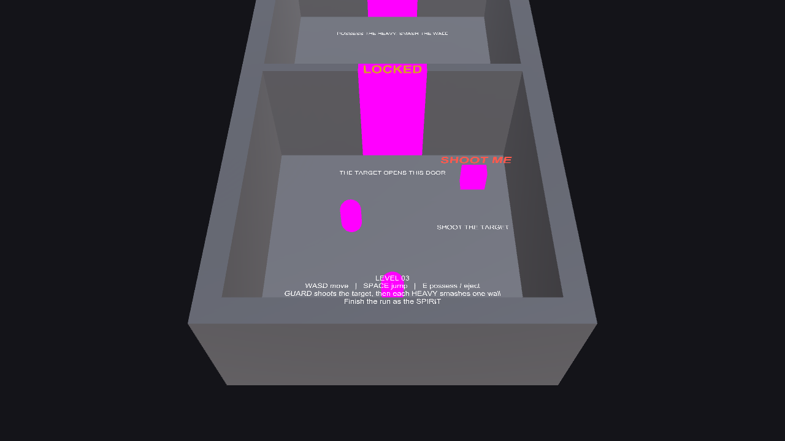

# POSESSION

POSESSION is a short third-person puzzle prototype about a spirit that takes control
of enemies to use their unique abilities. Possess Guards to shoot targets, switch to
Heavy enemies to break walls, and return to spirit form to reach each exit before the
timer runs out.

[Play the WebGL build](https://ruturaj-mohalkar-25.github.io/POSESSION/)

## Controls

- `WASD` — move the current form
- `Space` — jump as the spirit
- `E` — possess a nearby enemy or eject from the current host
- Left mouse button — use the possessed enemy's ability

## Gameplay

- Patrol Guards detect and chase the spirit, can be possessed, and fire projectiles.
- Heavy enemies move more slowly, have extra health, and smash breakable walls.
- Targets unlock doors, while possession and level timers keep each run moving.
- Three levels introduce the mechanics and combine them into multi-room puzzles.

## Running the project

Open the repository folder in Unity `6000.3.22f1`, then load `Assets/Scenes/MainMenu.unity`
or any `Level_0X` scene. The included PlayMode suite can be run from
`Window > General > Test Runner`.

## Team

- Ruturaj Mohalkar — spirit, possession, shooting, puzzles, and integration
- Ansh Parasher — Guard enemy and shared enemy behavior
- Omkar — Heavy enemy and smash mechanics
- Utkarsh — level design and puzzle layouts
- Ramya — HUD, UI, and visual polish
